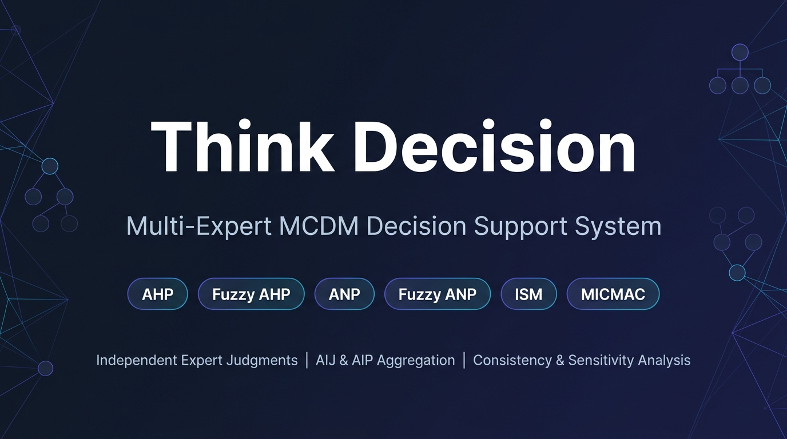

<p align="center">
  
</p>

<p align="center">
  <a href="README.md">English</a> · <strong>Bahasa Indonesia</strong>
</p>

# Think Decision — Sistem Pendukung Keputusan MCDM Multi-Pakar

Think Decision adalah platform **Multi-Criteria Decision Making (MCDM)** berbasis web untuk pengambilan keputusan multi-pakar. Pembuat kasus (*creator*) menyusun masalah keputusan (tujuan, kriteria, sub-kriteria, alternatif, atau elemen ISM), mengundang pakar, mengumpulkan penilaian secara independen tanpa saling memengaruhi, lalu mensintesis bobot prioritas, peringkat alternatif, analisis konsistensi, dan analisis sensitivitas.

Antarmuka web tersedia dalam dua bahasa (**Bahasa Inggris sebagai default**, dengan tombol pengalih **ID / EN** di bilah atas).

## Metode yang Didukung

| Metode | Kegunaan | Sintesis / Output |
|---|---|---|
| **AHP** | Perbandingan berpasangan hierarkis dengan skala Saaty 1–9 | Bobot vektor eigen utama (*power method*), peringkat alternatif, Consistency Ratio (CR) |
| **Fuzzy AHP** | Perbandingan berpasangan dengan *Triangular Fuzzy Numbers* (TFN) untuk menangkap ketidakpastian | *Fuzzy geometric mean* Buckley + defuzzifikasi centroid |
| **ANP** | Model keputusan berbentuk jaringan dengan ketergantungan antar-kriteria | Sintesis *supermatrix* dan *limit matrix*, bobot jaringan |
| **Fuzzy ANP** | Kombinasi ANP dan *Triangular Fuzzy Numbers* | Sintesis *fuzzy supermatrix* untuk kriteria yang saling bergantung dan tidak pasti |
| **ISM** | *Interpretive Structural Modelling* (relasi SSIM `V/A/X/O`) | Matriks ketercapaian (*reachability matrix*), partisi level, struktur hierarki, dan konsensus antar-pakar |
| **MICMAC** | Analisis turunan otomatis dari kasus ISM yang telah selesai | Kuadran *driving power* vs. *dependence power* (Autonomous, Dependent, Linkage, Independent) |

## Fitur Utama

- **Alur Kerja Multi-Pakar Independen** — Pembuat kasus dapat mengundang pakar dengan bobot agregasi setara atau berbeda; setiap pakar menilai secara mandiri tanpa melihat penilaian pakar lain.
- **Agregasi Kelompok Fleksibel** — Pilih antara **AIJ** (*Aggregation of Individual Judgments*, rata-rata geometrik berbobot) dan **AIP** (*Aggregation of Individual Priorities*, rata-rata aritmetika berbobot) untuk AHP/ANP, atau suara mayoritas untuk ISM.
- **Pemeriksaan Konsistensi & Konsensus Real-Time** — Perhitungan Consistency Ratio (CR) per pakar dan per level beserta saran perbaikan untuk AHP/ANP, serta skor konsensus antar-pakar untuk ISM.
- **Hasil Interaktif & Analisis Sensitivitas** — Bobot kriteria, peringkat alternatif, analisis divergensi antar-pakar, slider simulasi *what-if* bobot, serta ekspor (PDF, CSV/Excel, diagram hierarki PNG, JSON).
- **Analitik & Jejak Audit** — Dashboard analitik dengan tren aktivitas bulanan, distribusi CR, dan log audit aktivitas sistem.
- **Antarmuka Dwibahasa (EN / ID)** — Menggunakan Bahasa Inggris sebagai default dan dapat dialihkan langsung ke Bahasa Indonesia.

## Struktur Proyek

```text
backend/               REST API Node.js / Express + Supabase (/api/v1, port 3000)
frontend/              React (no-build, Babel standalone) — DecideAI.html (port 8000)
supabase/migrations/   Skema PostgreSQL dan migrasi bertahap (jalankan berurutan)
docs/                  Dokumen arsitektur, PRD, ERD, panduan deploy, dan aset README
compose.yaml           Konfigurasi Docker Compose (backend + frontend + Redis)
```

## Mulai Cepat

Kedua opsi berikut membutuhkan [pengaturan database Supabase](#pengaturan-database-proyek-supabase-baru) terlebih dahulu.

### Opsi A — Docker (Direkomendasikan)

```bash
# 1. Isi variabel lingkungan (lihat bagian Variabel Lingkungan di bawah).
#    Untuk Docker, atur REDIS_URL=redis://redis:6379 (nama service Redis di compose.yaml).
cp backend/.env.example backend/.env

# 2. Bangun dan jalankan seluruh layanan.
docker compose up -d --build

# 3. Pastikan backend berjalan normal.
curl http://localhost:3000/health
```

- **Frontend:** `http://localhost:8000/DecideAI.html`
- **Backend API:** `http://localhost:3000`
- **Dokumentasi API Swagger:** `http://localhost:3000/api/docs`

### Opsi B — Manual (Pengembangan Lokal)

Windows (PowerShell):
```powershell
.\start-all.ps1
```

OS lainnya:
```bash
# Terminal 1 — Backend
cd backend
npm install        # cukup sekali
npm start          # http://localhost:3000 (health check: /health)

# Terminal 2 — Frontend
cd frontend
python -m http.server 8000
# Buka http://localhost:8000/DecideAI.html
```

Pada mode manual/dev, `REDIS_URL` dapat dikosongkan (backend otomatis memakai penyimpanan *in-memory* untuk *refresh-token denylist*). Pada mode Docker/produksi (`NODE_ENV=production`), `REDIS_URL` wajib diisi.

## Pengaturan Database (Proyek Supabase Baru)

1. Buat proyek baru di [Supabase Dashboard](https://supabase.com/dashboard).
2. Buka **SQL Editor** dan jalankan seluruh file `.sql` di `supabase/migrations/` **sesuai urutan nama file**, dimulai dari `2025100100_initial_schema.sql`.
3. Salin `backend/.env.example` menjadi `backend/.env` dan lengkapi kredensialnya.

## Variabel Lingkungan

Dikonfigurasi di `backend/.env` (templat: `backend/.env.example`, atau `backend/.env.prod` untuk produksi melalui `compose.yaml`).

| Variabel | Wajib | Keterangan |
|---|---|---|
| `SUPABASE_URL` | Ya | URL proyek Supabase (Settings → API) |
| `SUPABASE_SERVICE_KEY` | Ya | Kunci `service_role` Supabase (otorisasi ditangani langsung oleh backend) |
| `JWT_SECRET` | Ya | String acak rahasia (minimal 32 karakter) |
| `PORT` | Tidak | Port backend (default `3000`) |
| `NODE_ENV` | Tidak | `development` atau `production` |
| `CORS_ORIGIN` | Ya | Origin frontend yang diizinkan, misalnya `http://localhost:8000` |
| `REDIS_URL` | Hanya produksi | Penyimpanan bersama *refresh-token denylist* antar-instance/restart |
| `DOCS_ENABLED` | Tidak | Set `false` untuk menonaktifkan Swagger UI di `/api/docs` |

## Membuat Akun Pertama

Database baru belum memiliki akun. Daftarkan **Creator** pertama melalui form registrasi di UI atau `curl`:

```bash
curl -X POST http://localhost:3000/api/v1/auth/register \
  -H "Content-Type: application/json" \
  -c cookies.txt \
  -d '{"name":"Nama Anda","institution":"Institusi Anda","email":"creator@example.com","password":"min6characters","defaultMethod":"AHP"}'
```

Masuk sebagai creator di `http://localhost:8000/DecideAI.html`, buat kasus keputusan, lalu undang pakar dari Dashboard Creator. Setiap undangan pakar menghasilkan kata sandi sementara sekali pakai (ditampilkan sekali di UI/respons API untuk diteruskan ke pakar).

## Catatan Self-Hosting

- Backend membutuhkan proyek Supabase (baik yang di-host di supabase.com maupun *self-hosted*; `compose.yaml` hanya menjalankan backend, frontend, dan Redis).
- `frontend/DecideAI.html` memuat React, Babel standalone, Tailwind CSS, Recharts, html2pdf.js, dan Three.js dari CDN publik saat runtime; untuk lingkungan tanpa akses internet (*air-gapped*), file pustaka tersebut perlu disediakan secara lokal.

## Lisensi

MIT — lihat [LICENSE](LICENSE).
