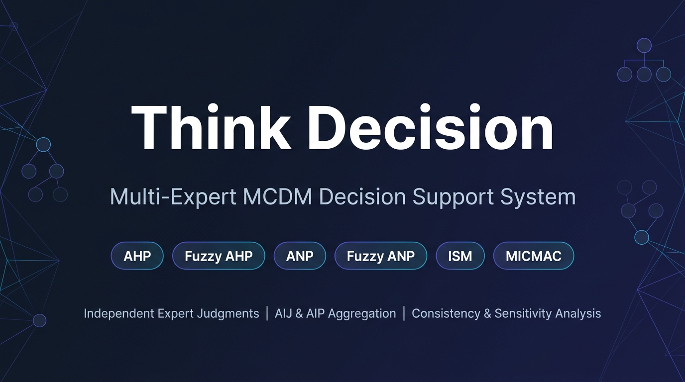

<p align="center">
  
</p>

<p align="center">
  <strong>English</strong> · <a href="README.id.md">Bahasa Indonesia</a>
</p>

# Think Decision — Multi-Expert MCDM Decision Support System

Think Decision is a web-based, multi-expert **Multi-Criteria Decision Making (MCDM)** platform. A case creator defines a decision problem (goal, criteria, sub-criteria, alternatives, or ISM elements), invites domain experts, collects independent judgments without cross-expert bias, and synthesizes group priorities, rankings, consistency metrics, and sensitivity analyses.

The web interface is bilingual (**English by default**, with an instant **ID / EN** toggle in the top bar).

## Supported Methods

| Method | Purpose | Synthesis / Output |
|---|---|---|
| **AHP** | Hierarchical pairwise comparisons using Saaty's 1–9 scale | Principal eigenvector weights (power method), alternative ranking, Consistency Ratio (CR) |
| **Fuzzy AHP** | Pairwise comparisons with Triangular Fuzzy Numbers (TFN) to model uncertainty | Buckley's fuzzy geometric mean + centroid defuzzification |
| **ANP** | Network decision models with inner dependencies among criteria | Supermatrix and limit matrix synthesis, network-adjusted weights |
| **Fuzzy ANP** | ANP combined with Triangular Fuzzy Numbers | Fuzzy supermatrix synthesis for uncertain, interdependent criteria |
| **ISM** | Interpretive Structural Modelling (SSIM `V/A/X/O` relations) | Reachability matrix, level partitioning, hierarchical structure, and cross-expert consensus |
| **MICMAC** | Derived automatically from a completed ISM case | Driving power vs. dependence power quadrant classification (Autonomous, Dependent, Linkage, Independent) |

## Key Features

- **Blind Multi-Expert Workflow** — Creators invite experts with weighted or equal aggregation; each expert evaluates independently without seeing other experts' judgments.
- **Flexible Group Aggregation** — Switch between **AIJ** (*Aggregation of Individual Judgments*, weighted geometric mean) and **AIP** (*Aggregation of Individual Priorities*, weighted arithmetic mean) for AHP/ANP, or majority vote for ISM.
- **Real-Time Consistency & Consensus** — Per-expert and per-level Consistency Ratio (CR) checks with inconsistency suggestions for AHP/ANP, plus cross-expert consensus scoring for ISM.
- **Interactive Results & Sensitivity Analysis** — Criteria weights, alternative rankings, divergence/discrepancy views, interactive weight what-if sliders, and exports (PDF, CSV/Excel, PNG hierarchy diagram, JSON).
- **Analytics & Audit Trail** — Creator dashboard with monthly activity trends, CR distribution, and an audit log of system actions.
- **Bilingual UI (EN / ID)** — Defaults to English for international audiences and switches cleanly to Bahasa Indonesia.

## Project Structure

```text
backend/               Node.js / Express + Supabase REST API (/api/v1, port 3000)
frontend/              React (no-build, Babel standalone) — DecideAI.html (port 8000)
supabase/migrations/   PostgreSQL schema and incremental migrations (run in filename order)
docs/                  Architecture, PRD, ERD, deployment notes, and README assets
compose.yaml           Docker Compose stack (backend + frontend + Redis)
```

## Quick Start

Both options require setting up the [Supabase database](#database-setup-fresh-supabase-project) first.

### Option A — Docker (Recommended)

```bash
# 1. Configure environment variables (see Environment Variables below).
#    For Docker, set REDIS_URL=redis://redis:6379 (the Redis service name in compose.yaml).
cp backend/.env.example backend/.env

# 2. Build and start the stack.
docker compose up -d --build

# 3. Verify the backend is healthy.
curl http://localhost:3000/health
```

- **Frontend:** `http://localhost:8000/DecideAI.html`
- **Backend API:** `http://localhost:3000`
- **Swagger API Docs:** `http://localhost:3000/api/docs`

### Option B — Manual (Local Development)

Windows (PowerShell):
```powershell
.\start-all.ps1
```

Any OS:
```bash
# Terminal 1 — Backend
cd backend
npm install        # first time only
npm start          # http://localhost:3000 (health check: /health)

# Terminal 2 — Frontend
cd frontend
python -m http.server 8000
# Open http://localhost:8000/DecideAI.html
```

In manual/dev mode, `REDIS_URL` may be left empty (the backend falls back to an in-memory refresh-token denylist). In Docker/production (`NODE_ENV=production`), `REDIS_URL` is required.

## Database Setup (Fresh Supabase Project)

1. Create a new project in the [Supabase Dashboard](https://supabase.com/dashboard).
2. Open **SQL Editor** and run every `.sql` file in `supabase/migrations/` **in filename order**, starting with `2025100100_initial_schema.sql`.
3. Copy `backend/.env.example` to `backend/.env` and fill in your credentials.

## Environment Variables

Configured in `backend/.env` (template: `backend/.env.example`, or `backend/.env.prod` for production via `compose.yaml`).

| Variable | Required | Description |
|---|---|---|
| `SUPABASE_URL` | Yes | Supabase project URL (Settings → API) |
| `SUPABASE_SERVICE_KEY` | Yes | Supabase `service_role` key (backend enforces authorization directly) |
| `JWT_SECRET` | Yes | Random secret string (32+ characters) |
| `PORT` | No | Backend port (defaults to `3000`) |
| `NODE_ENV` | No | `development` or `production` |
| `CORS_ORIGIN` | Yes | Allowed frontend origin, e.g. `http://localhost:8000` |
| `REDIS_URL` | Production only | Shared refresh-token denylist across instances/restarts |
| `DOCS_ENABLED` | No | Set `false` to disable `/api/docs` Swagger UI |

## Creating the First Account

A fresh database has no accounts. Register the first **Creator** via the UI registration form or `curl`:

```bash
curl -X POST http://localhost:3000/api/v1/auth/register \
  -H "Content-Type: application/json" \
  -c cookies.txt \
  -d '{"name":"Your Name","institution":"Your Institution","email":"creator@example.com","password":"min6characters","defaultMethod":"AHP"}'
```

Log in as that creator at `http://localhost:8000/DecideAI.html`, create a decision case, and invite experts from the Creator Dashboard. Each expert invitation generates a one-time temporary password (displayed once in the UI/API response so you can share it with the expert).

## Self-Hosting Notes

- The backend requires a Supabase project (hosted on supabase.com or self-hosted; `compose.yaml` runs the backend, frontend, and Redis).
- `frontend/DecideAI.html` loads React, Babel standalone, Tailwind CSS, Recharts, html2pdf.js, and Three.js from public CDNs at runtime; air-gapped deployments must vendor those scripts locally.

## License

MIT — see [LICENSE](LICENSE).
