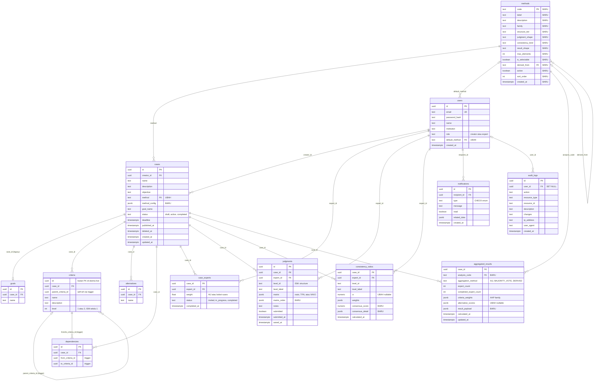

# ERD — ThinkDecision Multi-Method DSS

| | |
|---|---|
| **Versi** | 1.0 (draf perencanaan) |
| **Tanggal** | 2026-10-06 |
| **Dokumen terkait** | [PRD_Multi_Method_DSS.md](PRD_Multi_Method_DSS.md) |
| **DBMS** | PostgreSQL (Supabase) |

> **Catatan sumber.** Tabel inti dibuat lewat dashboard Supabase, bukan lewat migrasi di repo. Kolom di bawah direkonstruksi dari migrasi `supabase/migrations/*.sql` dan pemanggilan `.select()/.insert()/.update()` di `backend/src/services/`. Tipe kolom yang ditandai `?` belum terverifikasi dari skema live — **wajib dicocokkan di Fase 0** (lihat PRD §13) sebelum migrasi ditulis.

Legenda: **[BARU]** tabel/kolom baru · **[UBAH]** kolom/constraint diubah · tanpa tanda = tidak berubah.

---

## 1. Diagram ERD



Ringkasan kardinalitas utama:
- Satu `methods` dipakai banyak `cases`; satu `cases` punya tepat satu metode.
- Satu `cases` ISM menghasilkan **dua** baris `aggregated_results` (`analysis_code` = `ISM` dan `MICMAC`); case AHP family tetap satu baris.
- `methods.derived_from` adalah self-reference: `MICMAC.derived_from = 'ISM'`.

---

## 2. Kamus Data per Tabel

### 2.1 `methods` **[BARU]**

Registry metode. Satu baris per metode; ditambah lewat migrasi seed.

| Kolom | Tipe | Null | Default | Constraint | Keterangan |
|---|---|---|---|---|---|
| `code` | text | tidak | — | PK, CHECK `code ~ '^[A-Z][A-Z0-9_]*$'` | Kode stabil, dipakai di FK |
| `label` | text | tidak | — | — | Nama tampilan, mis. "Fuzzy AHP" |
| `description` | text | ya | — | — | Deskripsi singkat untuk wizard |
| `family` | text | tidak | — | CHECK in (`pairwise_ratio`, `structural`) | Keluarga metode |
| `structure_tier` | text | tidak | — | CHECK in (`two_tier`, `single_tier`) | Bentuk struktur case |
| `judgment_shape` | text | ya | — | CHECK in (`ratio_matrix`, `fuzzy_ratio_matrix`, `binary_relation_matrix`, `cross_impact_matrix`) | NULL untuk metode turunan (tanpa input pakar) |
| `consistency_kind` | text | tidak | — | CHECK in (`cr`, `consensus`, `none`) | Jenis cek kualitas |
| `result_shape` | text | tidak | — | CHECK in (`ranking`, `network_ranking`, `level_partition`, `quadrant_scatter`) | Menentukan komponen hasil di frontend |
| `max_elements` | int | tidak | 20 | CHECK > 1 | Batas ukuran matriks (menggantikan `MAX_MATRIX_SIZE`) |
| `is_selectable` | boolean | tidak | true | — | `false` = tidak bisa dipilih langsung di wizard |
| `derived_from` | text | ya | — | FK → `methods(code)` | Metode induk untuk analisis turunan |
| `active` | boolean | tidak | true | — | Menonaktifkan metode tanpa menghapus |
| `sort_order` | int | tidak | 0 | — | Urutan tampil |
| `created_at` | timestamptz | tidak | `now()` | — | — |

Constraint tambahan: CHECK `derived_from IS NULL OR is_selectable = false` — metode turunan tidak bisa dipilih langsung.

**Data seed:**

| code | label | family | structure_tier | judgment_shape | consistency_kind | result_shape | max_elements | is_selectable | derived_from |
|---|---|---|---|---|---|---|---|---|---|
| `AHP` | AHP | pairwise_ratio | two_tier | ratio_matrix | cr | ranking | 20 | true | — |
| `ANP` | ANP | pairwise_ratio | two_tier | ratio_matrix | cr | network_ranking | 20 | true | — |
| `FUZZY_AHP` | Fuzzy AHP | pairwise_ratio | two_tier | fuzzy_ratio_matrix | cr | ranking | 20 | true | — |
| `FUZZY_ANP` | Fuzzy ANP | pairwise_ratio | two_tier | fuzzy_ratio_matrix | cr | network_ranking | 20 | true | — |
| `ISM` | ISM | structural | single_tier | binary_relation_matrix | consensus | level_partition | 40 | true | — |
| `MICMAC` | MICMAC | structural | single_tier | — | none | quadrant_scatter | 40 | false | `ISM` |

`cross_impact_matrix` disiapkan di CHECK untuk MICMAC standalone / DEMATEL di masa depan; belum dipakai metode mana pun.

### 2.2 `users` **[UBAH]**

| Kolom | Tipe | Null | Constraint | Perubahan |
|---|---|---|---|---|
| `id` | uuid | tidak | PK | — |
| `email` | text | tidak | unik `lower(email)` (`users_email_lower_unique`) | — |
| `password_hash` | text | tidak | — | — |
| `name` | text | ya? | — | — |
| `institution` | text | ya | — | — |
| `role` | text | tidak | `creator` \| `expert` | — |
| `default_method` | text | ya | **FK → `methods(code)` ON UPDATE CASCADE** | **[UBAH]** nilai `'Fuzzy AHP'`/`'Fuzzy ANP'` dinormalisasi, lalu FK |
| `created_at` | timestamptz | tidak | — | — |

### 2.3 `cases` **[UBAH]**

| Kolom | Tipe | Null | Constraint | Perubahan |
|---|---|---|---|---|
| `id` | uuid | tidak | PK | — |
| `creator_id` | uuid | tidak | FK → `users(id)` | — |
| `name` | text | tidak | — | — |
| `description` | text | ya | — | — |
| `objective` | text | ya | — | — |
| `method` | text | tidak | **FK → `methods(code)` ON UPDATE CASCADE ON DELETE RESTRICT** | **[UBAH]** dinormalisasi lalu FK. Larangan memilih metode `is_selectable = false` ditegakkan di aplikasi |
| `method_config` | jsonb | tidak | default `'{}'::jsonb` | **[BARU]** konfigurasi khusus metode |
| `goal_name` | text | ya | — | — |
| `status` | text | tidak | `draft` \| `active` \| `completed` | — |
| `deadline` | timestamptz | ya | — | — |
| `published_at` | timestamptz | ya | — | — |
| `deleted_at` | timestamptz | ya | — | soft delete |
| `created_at`, `updated_at` | timestamptz | tidak | — | — |

Contoh `method_config`:
```json
{ "contextual_relation": "memengaruhi", "tie_rule": "zero" }
```
Untuk AHP family: `{}`.

### 2.4 `goals` (legacy)
Tidak berubah. Tetap dijadwalkan drop setelah `cases.goal_name` terisi penuh (migrasi `2025100105_goals.sql`).

### 2.5 `criteria`
Tidak berubah. Untuk metode `single_tier`, setiap elemen disimpan sebagai `level = 1`, `parent_criteria_id = NULL`.

| Kolom | Tipe | Catatan |
|---|---|---|
| `id` | uuid | **Bukan PK/unique di skema live** — FK ke `criteria(id)` gagal (error 42830); relasi divalidasi trigger `check_criteria_parent` dan `check_dependency_criteria` |
| `case_id` | uuid | FK → `cases(id)` ON DELETE CASCADE |
| `parent_criteria_id` | uuid | Self-ref via trigger; CHECK `criteria_no_self_parent` |
| `name`, `description` | text | Untuk ISM: nama dan penjelasan faktor |
| `level` | int | 1 atau 2; ISM/MICMAC selalu 1 |

> Rekomendasi opsional (terpisah dari rilis ini): tambah `UNIQUE (id)` pada `criteria` agar relasi ke elemen bisa memakai FK sungguhan. Tidak wajib untuk ISM.

### 2.6 `alternatives`, `dependencies`
Tidak berubah. Case ISM tidak punya baris di kedua tabel ini (`validateStructure` ISM menolaknya). `dependencies` tetap khusus ANP — relasi ISM berasal dari pakar dan disimpan di `judgments`.

### 2.7 `case_experts`
Struktur tidak berubah. Unik `(case_id, expert_id)`; FK RESTRICT ke `cases` dan `users`.
Semantik `weight` diperluas: AHP family = bobot geometric mean (AIJ); ISM = bobot suara pada voting mayoritas (default 1).

### 2.8 `judgments` **[UBAH]**

| Kolom | Tipe | Null | Constraint | Perubahan |
|---|---|---|---|---|
| `id` | uuid | tidak | PK | — |
| `case_id` | uuid | tidak | FK → `cases(id)` CASCADE | — |
| `expert_id` | uuid | tidak | FK → `users(id)` RESTRICT | — |
| `level_id` | text | tidak | unik `(case_id, expert_id, level_id)` | ISM: konstanta `'structure'` |
| `level_label` | text | ya | — | — |
| `matrix` | jsonb | tidak | — | Isi diperluas: simbol V/A/X/O |
| `matrix_order` | jsonb | ya | — | **[BARU]** array id elemen sesuai urutan baris/kolom `matrix` |
| `notes` | text | ya | — | — |
| `submitted` | boolean | tidak | default false | — |
| `submitted_at`, `saved_at` | timestamptz | ya | — | — |

Bentuk `matrix` per `judgment_shape`:

| judgment_shape | Isi sel | Contoh matriks 3×3 |
|---|---|---|
| `ratio_matrix` | angka | `[[1,3,0.2],[0.333,1,0.5],[5,2,1]]` |
| `fuzzy_ratio_matrix` | `[l,m,u]` | `[[[1,1,1],[2,3,4],…],…]` |
| `binary_relation_matrix` | `"V"`/`"A"`/`"X"`/`"O"`/`null` | `[[null,"V","O"],[null,null,"A"],[null,null,null]]` |

`matrix_order` contoh: `["<uuid e1>", "<uuid e2>", "<uuid e3>"]`. Untuk AHP family boleh NULL (perilaku lama).

### 2.9 `consistency_ratios` **[UBAH]**

| Kolom | Tipe | Null | Constraint | Perubahan |
|---|---|---|---|---|
| `case_id` | uuid | tidak | FK → `cases(id)` CASCADE | — |
| `expert_id` | uuid | tidak | unik `(case_id, expert_id, level_id)` | — |
| `level_id` | text | tidak | — | — |
| `level_label` | text | ya | — | — |
| `cr` | numeric | **ya** | — | **[UBAH]** DROP NOT NULL (bila ada); NULL untuk ISM |
| `weights` | jsonb | ya | — | AHP: bobot prioritas; ISM: Initial Reachability Matrix biner pakar |
| `consensus_score` | numeric | ya | CHECK 0..1 | **[BARU]** kesesuaian pakar terhadap matriks konsensus |
| `consensus_detail` | jsonb | ya | — | **[BARU]** detail per sel |
| `calculated_at` | timestamptz | tidak | — | — |

Contoh `consensus_detail` (baris pakar ISM):
```json
{ "agree_cells": 41, "total_cells": 45, "disagree": [[0,3],[2,5]] }
```
Skor konsensus keseluruhan case (termasuk daftar sel `tie`) disimpan di `aggregated_results.result_payload.consensus`, bukan di tabel ini.

### 2.10 `aggregated_results` **[UBAH]**

| Kolom | Tipe | Null | Constraint | Perubahan |
|---|---|---|---|---|
| `case_id` | uuid | tidak | FK → `cases(id)` CASCADE | — |
| `analysis_code` | text | tidak | FK → `methods(code)`; **UNIQUE `(case_id, analysis_code)`** | **[BARU]** backfill = `cases.method` |
| `aggregation_method` | text | tidak | — | Nilai baru: `MAJORITY_VOTE` (ISM), `DERIVED` (MICMAC) |
| `expert_count` | int | ya | — | — |
| `completed_expert_count` | int | ya | — | — |
| `criteria_weights` | jsonb | ya | — | Khusus AHP family; NULL untuk ISM/MICMAC |
| `alternative_scores` | jsonb | **ya** | — | **[UBAH]** DROP NOT NULL; NULL untuk ISM/MICMAC |
| `result_payload` | jsonb | ya | — | **[BARU]** hasil generik per `result_shape` |
| `calculated_at`, `updated_at` | timestamptz | tidak | — | — |

Contoh `result_payload` — **ISM** (`level_partition`), 4 elemen sintetis:
```json
{
  "element_order": ["e1", "e2", "e3", "e4"],
  "consensus": { "score": 0.87, "ties": [[1, 3]], "tie_rule": "zero" },
  "consensus_ssim": [[null,"V","O","V"],[null,null,"A","O"],[null,null,null,"V"],[null,null,null,null]],
  "final_reachability": [[1,1,0,1],[0,1,0,0],[0,1,1,1],[0,0,0,1]],
  "transitive_cells": [],
  "iterations": [
    { "level": 1, "elements": ["e2", "e4"] },
    { "level": 2, "elements": ["e1", "e3"] }
  ],
  "digraph_edges": [["e1","e2"],["e1","e4"],["e3","e2"],["e3","e4"]]
}
```

Contoh `result_payload` — **MICMAC** (`quadrant_scatter`), dari matriks di atas (batas n/2 = 2):
```json
{
  "source_analysis": "ISM",
  "threshold": 2,
  "elements": [
    { "id": "e1", "driving": 3, "dependence": 1, "quadrant": "independent", "on_boundary": false },
    { "id": "e2", "driving": 1, "dependence": 3, "quadrant": "dependent",   "on_boundary": false },
    { "id": "e3", "driving": 3, "dependence": 1, "quadrant": "independent", "on_boundary": false },
    { "id": "e4", "driving": 1, "dependence": 3, "quadrant": "dependent",   "on_boundary": false }
  ]
}
```

Dengan kunci unik baru, case AHP family tetap punya tepat satu baris (`analysis_code = cases.method`); case ISM punya dua.

### 2.11 `notifications`
Tidak berubah. Kolom nyata (dari `backend/src/services/notificationService.js`): `id`, `recipient_id` (FK → `users`, RESTRICT), `type` (CHECK enum, lihat `2025100106_notification_types.sql`), `message`, `read`, `related_data` (jsonb — title, caseId, expertId, actionUrl), `created_at`. Tipe yang ada (`aggregation_ready`, `case_completed`, `expert_completed`) cukup untuk ISM.

### 2.12 `audit_logs`
Tidak berubah. Kolom nyata (dari `backend/src/services/auditService.js`): `id`, `user_id` (FK → `users`, SET NULL), `action`, `resource_type`, `resource_id`, `description`, `changes`, `ip_address`, `user_agent`, `created_at`.

---

## 3. Urutan Migrasi

Semua langkah idempoten, mengikuti pola migrasi yang ada (`IF NOT EXISTS`, `EXCEPTION WHEN duplicate_object`, FK `NOT VALID` lalu `VALIDATE`). Nama file mengikuti konvensi `supabase/migrations/YYYYMMDDNN_*.sql`.

| # | Migrasi | Isi | Rollback |
|---|---|---|---|
| 0 | — (Fase 0) | Dump skema live; verifikasi tipe kolom bertanda `?`, constraint unik/PK `aggregated_results` yang sebenarnya, dan nullability `cr`/`alternative_scores` | — |
| 1 | `_methods.sql` | `CREATE TABLE methods` + CHECK + seed 6 baris (`INSERT … ON CONFLICT (code) DO UPDATE`) | `DROP TABLE methods` (setelah langkah 2 dan 5 di-rollback) |
| 2 | `_method_codes.sql` | `UPDATE cases SET method = 'FUZZY_AHP' WHERE method = 'Fuzzy AHP'` (sama untuk `FUZZY_ANP`, dan untuk `users.default_method`); pastikan tidak ada nilai di luar `methods.code`; tambah FK `NOT VALID` lalu `VALIDATE` | UPDATE balik ke string lama; DROP FK |
| 3 | `_method_config.sql` | `cases.method_config jsonb NOT NULL DEFAULT '{}'`; `judgments.matrix_order jsonb` | DROP COLUMN |
| 4 | `_consistency_generic.sql` | `consistency_ratios.cr DROP NOT NULL`; ADD `consensus_score`, `consensus_detail` | DROP COLUMN (data konsensus ISM hilang) |
| 5 | `_aggregated_generic.sql` | ADD `analysis_code` nullable → backfill `= cases.method` → SET NOT NULL → FK; ADD `result_payload`; `alternative_scores DROP NOT NULL`; ganti unique/PK lama dengan `UNIQUE (case_id, analysis_code)` | Hapus baris non-AHP, kembalikan unique lama, DROP COLUMN |

**Langkah 2 dan 5 harus dirilis bersamaan dengan perubahan kode:**
- Langkah 2: alias kode lama di API (PRD FR-05) sudah terpasang **sebelum** migrasi dijalankan.
- Langkah 5: upsert di `judgmentService.calculateAndStoreAggregatedResults` (saat ini tanpa `onConflict`) diubah memakai `onConflict: 'case_id,analysis_code'` dan menyertakan `analysis_code`; semua `select` dari `aggregated_results` menambah filter `analysis_code`.

Kueri verifikasi pasca-migrasi (ditambahkan ke `supabase/verifikasi.sql`):
```sql
SELECT method, count(*) FROM cases GROUP BY 1;                        -- hanya kode di methods
SELECT count(*) FROM aggregated_results WHERE analysis_code IS NULL;   -- 0
SELECT case_id, count(*) FROM aggregated_results
  GROUP BY 1 HAVING count(*) > 1;                                      -- hanya case ISM
```

---

## 4. Kompatibilitas Mundur

| Tabel | Yang tidak boleh rusak untuk AHP/ANP/Fuzzy | Cara menjaga |
|---|---|---|
| `methods` | — | Seed 4 metode lama mencerminkan perilaku sekarang |
| `cases` / `users` | Case lama tetap terbuka dengan metode yang sama | Normalisasi kode 1:1 + alias API selama transisi |
| `criteria` / `alternatives` / `dependencies` | Struktur 2 level dan dependensi ANP | Tidak ada perubahan kolom |
| `judgments` | Matriks lama terbaca; upsert `onConflict: 'case_id,expert_id,level_id'` | `matrix_order` nullable; kunci unik tidak berubah |
| `consistency_ratios` | CR lama tetap ada | Kolom baru nullable; `cr` tetap terisi untuk AHP family |
| `aggregated_results` | Satu baris hasil per case, kolom `criteria_weights`/`alternative_scores` | `analysis_code` = metode case; kolom lama dipertahankan dan tetap diisi untuk AHP family |
| `notifications` / `audit_logs` / `goals` | Semua | Tidak disentuh |

Verifikasi akhir: snapshot `GET /results/:caseId` semua case existing sebelum Fase 1 harus identik dengan hasil setelah Fase 2 (PRD NFR-01).
