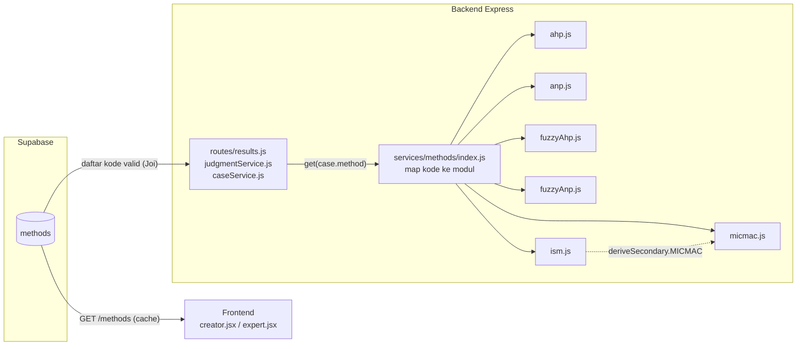
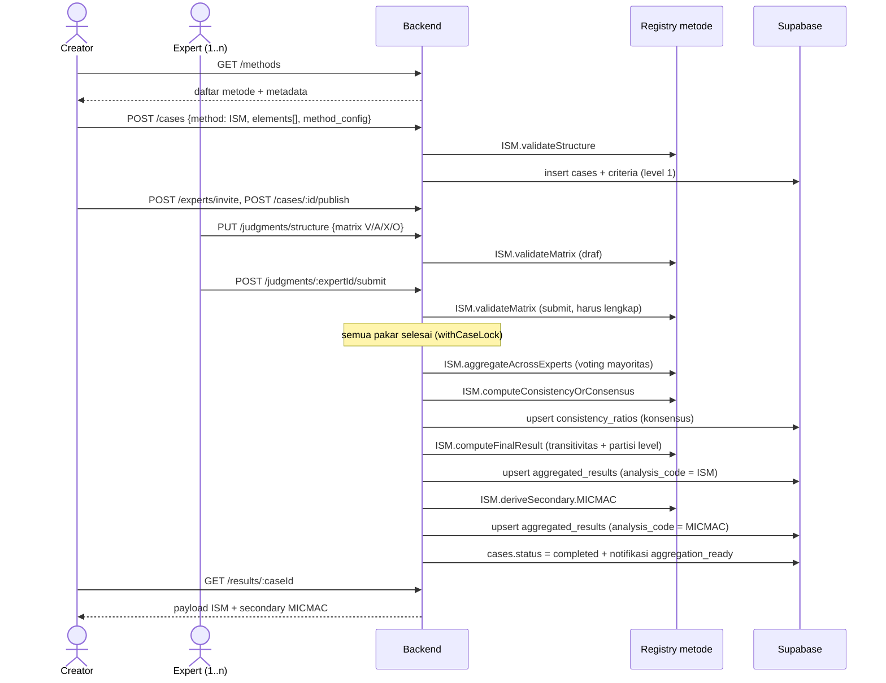

# PRD — ThinkDecision Multi-Method DSS

| | |
|---|---|
| **Versi** | 1.0 (draf perencanaan) |
| **Tanggal** | 2026-10-06 |
| **Status** | Siap direview — belum diimplementasikan |
| **Dokumen terkait** | [ERD_Multi_Method_DSS.md](ERD_Multi_Method_DSS.md) |

---

## 1. Ringkasan Eksekutif

ThinkDecision saat ini adalah platform keputusan multi-kriteria multi-pakar yang hanya mendukung satu keluarga metode: **AHP, ANP, Fuzzy AHP, Fuzzy ANP** (perbandingan berpasangan berbasis rasio). Dokumen ini mendefinisikan pengembangan ThinkDecision menjadi **platform DSS multi-metode** yang bisa menampung metode dengan bentuk data berbeda, dimulai dari **ISM (Interpretive Structural Modeling)** dan **MICMAC**, dengan arsitektur yang membuat metode berikutnya (DEMATEL, TOPSIS, SWOT, dll.) cukup ditambahkan lewat registry dan satu modul backend.

Prinsip desain: **perubahan skema minimal, reuse tabel yang ada, kompatibilitas mundur 100%** untuk 4 metode yang sudah berjalan.

## 2. Latar Belakang & Masalah

Hasil analisis codebase (per 2026-10-06):

| Masalah | Bukti di kode | Dampak |
|---|---|---|
| Daftar metode hardcoded | Joi `.valid('AHP','ANP','Fuzzy AHP','Fuzzy ANP')` di `backend/src/routes/auth.js:134`, `backend/src/routes/cases.js:16` dan `:98`; radio button di `frontend/src/creator.jsx:1310-1313` | Tambah metode = edit 4+ tempat |
| Logika semua metode di satu file | `backend/src/services/ahpService.js` (fungsi AHP, Fuzzy AHP, ANP bercampur) | Tidak ada batas modul per metode |
| Dispatch lewat string-match | `backend/src/routes/results.js` (816 baris): `isANP` di baris ~134, `method.includes('Fuzzy')` di ~262 dan ~525 | Setiap metode baru menambah cabang `if` |
| Agregasi mendeteksi metode dari bentuk data | `backend/src/services/judgmentService.js` `calculateAndStoreAggregatedResults`: fuzzy dideteksi dari `Array.isArray(sampleCell)` | Rapuh; matriks ISM akan diproses sebagai AHP crisp |
| Struktur kasus terkunci 2 tingkat | `backend/src/services/caseService.js` hardcode `level: 1` / `level: 2` (baris ~53, 68, 227, 243) | Tidak ada konsep "elemen tunggal" untuk ISM |
| Tabel hasil berbentuk AHP | `consistency_ratios.cr`, `aggregated_results.criteria_weights` / `alternative_scores` (NOT NULL) | Tidak ada tempat untuk partisi level ISM atau kuadran MICMAC |
| Batas ukuran matriks tertala AHP | `backend/src/services/validationService.js` `MAX_MATRIX_SIZE = 20` | Studi ISM lazim memakai 15–30 faktor |
| Tidak ada dokumentasi produk | Tidak ada PRD/ERD/`docs/` di repo | Dokumen ini mengisi kekosongan tersebut |

ISM dan MICMAC berbeda secara mendasar dari keluarga AHP:

| Aspek | Keluarga AHP | ISM | MICMAC |
|---|---|---|---|
| Struktur | 2 tingkat: kriteria (+sub) dan alternatif | 1 tingkat: elemen/faktor | 1 tingkat (sama dengan ISM) |
| Input pakar | Matriks rasio berpasangan skala Saaty 1–9 per level | Satu matriks relasi kontekstual V/A/X/O antar elemen | Tidak ada input baru (diturunkan dari ISM) |
| Cek kualitas | Consistency Ratio (CR ≤ 0,1) | Konsensus antar-pakar + transitivitas | — |
| Agregasi | Geometric mean tertimbang (AIJ) | Voting mayoritas per sel | — |
| Output | Ranking bobot/alternatif | Partisi level hierarki + digraf | Driving vs dependence power, 4 kuadran |

## 3. Tujuan & Sasaran

**Tujuan**
1. ThinkDecision mendukung metode DSS dengan bentuk struktur, input, dan output berbeda dalam satu platform.
2. Menambah metode baru tidak memerlukan perubahan di route, validator, atau file metode lain.
3. ISM dan MICMAC tersedia end-to-end sebagai implementasi pertama.

**Indikator keberhasilan**

| Indikator | Target |
|---|---|
| Regresi 4 metode lama | 0 perubahan hasil numerik pada case existing (diuji dengan snapshot hasil sebelum/sesudah) |
| Titik edit untuk metode baru | 1 baris seed `methods` + 1 file modul + 1 entri registry (+ komponen UI bila bentuk input/output baru) |
| String-match nama metode di backend | 0 sisa `method === '...'` / `.includes('Fuzzy')` di route dan service |
| ISM end-to-end | Creator buat case → pakar isi matriks → hasil partisi level + digraf tampil |
| MICMAC | Tersedia otomatis untuk setiap case ISM yang sudah selesai |

## 4. Lingkup

### 4.1 In-scope
- Tabel registry `methods` dan normalisasi kode metode.
- Refactor `ahpService.js` menjadi modul per metode **tanpa mengubah perilaku**.
- Metode **ISM**: input matriks V/A/X/O, voting mayoritas antar-pakar, transitivitas, partisi level, digraf.
- Analisis **MICMAC** sebagai turunan dari case ISM (tanpa sesi judgment terpisah).
- Generalisasi `consistency_ratios` dan `aggregated_results` untuk menampung hasil non-AHP.
- UI: wizard case untuk struktur satu tingkat, grid input relasi, tampilan digraf level dan scatter kuadran.
- Batas ukuran matriks per metode.

### 4.2 Out-of-scope (sengaja ditunda)
| Tidak dikerjakan | Alasan |
|---|---|
| Model EAV / atribut generik | Reuse `criteria`/`alternatives` sudah cukup untuk dua bentuk struktur |
| Rename tabel (`criteria` → `elements`) | Kosmetik; label UI diambil dari metadata metode |
| Tabel hasil per metode (`ism_results`, `micmac_results`) | Satu kolom `result_payload` JSONB cukup |
| Plugin hot-reload / dynamic loading | Tambah metode cukup lewat deploy biasa |
| Admin UI untuk katalog metode | Seed lewat migrasi SQL |
| MICMAC standalone (sesi judgment cross-impact sendiri) | Diputuskan: MICMAC hanya turunan ISM untuk rilis ini |
| Varian ISM lanjutan (Fuzzy-ISM, Grey-ISM, TISM) | Belum diminta |
| Resolusi konflik manual oleh creator | Diputuskan: voting mayoritas otomatis |
| Hierarki kriteria > 2 level | Tidak dibutuhkan ISM/MICMAC |
| Migrasi ke Supabase Auth | Rencana terpisah (`supabase/auth-migration-plan.md`) |
| Metode lain (DEMATEL, TOPSIS, SWOT) | Arsitektur menyiapkan jalurnya; implementasi di rilis berikutnya |

## 5. Pengguna & Peran

Peran tidak berubah.

| Peran | Kebutuhan baru di rilis ini |
|---|---|
| **Creator** (peneliti/pengambil keputusan) | Memilih ISM saat membuat case, mendefinisikan elemen dan pernyataan relasi kontekstual, melihat hasil ISM + MICMAC, mengekspor hasil |
| **Expert** (pakar) | Mengisi matriks relasi V/A/X/O antar elemen, menyimpan draf, submit |

## 6. User Stories

### Epic A — Registry metode
- **A1.** Sebagai creator, saya melihat daftar metode yang tersedia (dari server, bukan hardcoded) beserta deskripsi singkat, agar bisa memilih metode yang sesuai.
- **A2.** Sebagai developer, saya menambah metode baru dengan satu baris seed, satu file modul, dan satu entri registry, tanpa menyentuh route atau validator.

### Epic B — Case ISM
- **B1.** Sebagai creator, saat memilih ISM, wizard meminta **daftar elemen** (bukan kriteria + alternatif) dan **pernyataan relasi kontekstual** (mis. "Faktor i memengaruhi faktor j").
- **B2.** Sebagai creator, saya mengundang pakar dan memberi bobot pakar seperti pada case AHP.
- **B3.** Sebagai expert, saya mengisi matriks segitiga atas dengan simbol **V / A / X / O** untuk setiap pasangan elemen, menyimpan draf, dan submit.
- **B4.** Sebagai expert, saya melihat ringkasan isian (jumlah sel terisi, sel kosong) sebelum submit; submit ditolak bila ada sel kosong.
- **B5.** Sebagai creator, setelah semua pakar submit, saya melihat **matriks konsensus** (hasil voting mayoritas), **skor kesepakatan** per sel dan keseluruhan, serta sel yang seri.
- **B6.** Sebagai creator, saya melihat **Final Reachability Matrix** (setelah transitivitas), **tabel partisi level**, dan **digraf hierarki ISM**.

### Epic C — MICMAC (turunan ISM)
- **C1.** Sebagai creator, setiap case ISM yang selesai otomatis menyediakan tab **MICMAC** tanpa sesi input tambahan.
- **C2.** Sebagai creator, saya melihat driving power dan dependence power tiap elemen, serta **scatter plot 4 kuadran** (Autonomous, Dependent, Linkage, Independent/Driver).

### Epic D — Kompatibilitas
- **D1.** Sebagai creator lama, case AHP/ANP/Fuzzy yang sudah ada tetap terbuka, hasilnya identik, dan alurnya tidak berubah.

## 7. Functional Requirements

### 7.1 Registry metode
| ID | Requirement |
|---|---|
| FR-01 | Sistem menyimpan katalog metode di tabel `methods` dengan metadata: `family`, `structure_tier`, `judgment_shape`, `consistency_kind`, `result_shape`, `max_elements`, `is_selectable`, `derived_from`. |
| FR-02 | Endpoint baru `GET /api/v1/methods` mengembalikan metode aktif (`active = true`) beserta metadata; hasil di-cache lewat `cacheService.js` yang sudah ada. |
| FR-03 | Validasi `method` pada register, create case, dan update case memakai daftar kode dari `methods` (`is_selectable = true`), menggantikan 3 literal Joi. |
| FR-04 | Kode metode dinormalisasi: `AHP`, `ANP`, `FUZZY_AHP`, `FUZZY_ANP`, `ISM`, `MICMAC`. Nilai lama `'Fuzzy AHP'`/`'Fuzzy ANP'` dimigrasikan sekali. |
| FR-05 | Selama masa transisi, API menerima kode lama `'Fuzzy AHP'`/`'Fuzzy ANP'` di request dan memetakannya ke kode baru, supaya frontend lama tidak putus saat deploy bertahap. Dihapus setelah frontend diperbarui. |
| FR-06 | `MICMAC` memiliki `is_selectable = false` dan `derived_from = 'ISM'`: tidak bisa dipilih langsung di wizard. |

### 7.2 Pembuatan case per `structure_tier`
| ID | Requirement |
|---|---|
| FR-10 | Untuk `structure_tier = two_tier`, alur pembuatan case tetap seperti sekarang. |
| FR-11 | Untuk `structure_tier = single_tier`, wizard meminta daftar elemen (min. 3) dan menyimpannya sebagai baris `criteria` dengan `level = 1`, `parent_criteria_id = NULL`; tidak ada baris `alternatives`. |
| FR-12 | Case ISM menyimpan pernyataan relasi kontekstual di kolom baru `cases.method_config` (JSONB), mis. `{"contextual_relation": "memengaruhi"}`. |
| FR-13 | Validasi struktur dilakukan oleh modul metode (`validateStructure`): ISM menolak case dengan alternatif, < 3 elemen, atau melebihi `methods.max_elements`. |
| FR-14 | Aturan penguncian yang ada (`METHOD_LOCKED`, `STRUCTURE_LOCKED` setelah ada judgment) berlaku sama untuk ISM. |

### 7.3 Pengumpulan judgment per `judgment_shape`
| ID | Requirement |
|---|---|
| FR-20 | Modul metode menentukan level judgment lewat `getJudgmentLevels`. ISM memakai satu level dengan `level_id = 'structure'`. |
| FR-21 | Judgment ISM disimpan di `judgments.matrix` (JSONB) sebagai matriks n×n berisi simbol `"V"`, `"A"`, `"X"`, `"O"` di segitiga atas; diagonal dan segitiga bawah `null`. Urutan baris/kolom (id elemen) disimpan di kolom baru `judgments.matrix_order` agar matriks tetap terbaca benar meskipun urutan tampilan berubah. |
| FR-22 | Validasi matriks dilakukan per `judgment_shape`: `ratio_matrix` dan `fuzzy_ratio_matrix` memakai validasi sekarang; `binary_relation_matrix` mengecek ukuran n×n, simbol valid, dan kelengkapan saat submit. |
| FR-23 | Batas ukuran matriks diambil dari `methods.max_elements` (AHP family: 20 seperti sekarang; ISM: 40), menggantikan `MAX_MATRIX_SIZE` global. |
| FR-24 | Endpoint judgment yang ada (`POST/PUT /judgments/:levelId`, `POST /judgments/:expertId/submit`) dipakai ulang; tidak ada endpoint baru untuk ISM. |

### 7.4 Agregasi & konsensus
| ID | Requirement |
|---|---|
| FR-30 | Agregasi dipanggil lewat registry: `methods.get(case.method).aggregateAcrossExperts(...)`, menggantikan deteksi bentuk sel di `judgmentService.calculateAndStoreAggregatedResults`. |
| FR-31 | **ISM — konversi:** setiap matriks V/A/X/O pakar dikonversi menjadi Initial Reachability Matrix biner (V: a_ij=1, a_ji=0; A: a_ij=0, a_ji=1; X: keduanya 1; O: keduanya 0; diagonal 1). |
| FR-32 | **ISM — voting mayoritas:** untuk setiap sel (i,j), nilai konsensus = 1 bila jumlah bobot pakar yang memberi 1 **> 50%** total bobot pakar; selain itu 0. Bobot dari `case_experts.weight` (default 1, sehingga tanpa pengaturan = suara mayoritas biasa). |
| FR-33 | **ISM — seri:** bila tepat 50%, sel ditandai `tie` di `consensus_detail` dan diputuskan dengan aturan default **0 (tidak ada relasi)**. Aturan ini ditampilkan di UI hasil. |
| FR-34 | **ISM — skor kesepakatan:** sistem menghitung persentase sel dengan kesepakatan penuh dan rata-rata kesepakatan per sel; disimpan di `consistency_ratios.consensus_score` / `consensus_detail` (baris per pakar menyimpan tingkat kesesuaian pakar tersebut terhadap matriks konsensus). |
| FR-35 | **ISM — transitivitas:** Final Reachability Matrix dihitung dari matriks konsensus dengan transitive closure (Warshall); sel hasil transitivitas ditandai `1*`. Dilakukan **setelah** voting (praktik standar ISM). |
| FR-36 | **ISM — partisi level:** iteratif dengan reachability set, antecedent set, dan intersection set; elemen dengan reachability = intersection ditempatkan di level saat ini lalu dihapus, sampai semua elemen terpartisi. |
| FR-37 | **MICMAC:** setelah hasil ISM tersimpan, modul ISM memanggil `deriveSecondary.MICMAC` untuk menghitung driving power (jumlah baris) dan dependence power (jumlah kolom) dari Final Reachability Matrix, mengklasifikasi kuadran dengan batas tengah n/2, dan menyimpan baris `aggregated_results` kedua dengan `analysis_code = 'MICMAC'`. |
| FR-38 | Untuk keluarga AHP, perilaku agregasi (AIJ tertimbang, fuzzy AIJ, CR) **tidak berubah**. |

### 7.5 Hasil & visualisasi per `result_shape`
| ID | Requirement |
|---|---|
| FR-40 | `GET /results/:caseId` mendispatch ke `computeFinalResult` modul metode dan mengembalikan `{ method, result_shape, payload, secondary: [...] }` untuk metode non-AHP; respons AHP family tetap berbentuk seperti sekarang. |
| FR-41 | `level_partition` (ISM): tabel SSIM konsensus, Final Reachability Matrix (dengan penanda `1*`), tabel iterasi partisi level, dan digraf hierarki (level teratas di atas). |
| FR-42 | `quadrant_scatter` (MICMAC): scatter Recharts dengan sumbu X = dependence, Y = driving, garis batas n/2, label elemen, dan tabel driving/dependence power. |
| FR-43 | Sensitivity analysis (`POST /results/:caseId/sensitivity`) dan discrepancy (`GET /results/:caseId/discrepancy`) hanya untuk metode dengan `result_shape` `ranking`/`network_ranking`; metode lain mendapat 422 dengan pesan jelas. Discrepancy ISM digantikan oleh tampilan konsensus (FR-34). |
| FR-44 | Ekspor PDF (html2pdf, sudah ada) mencakup tampilan ISM dan MICMAC. |
| FR-45 | Semua pembacaan `aggregated_results` memfilter `analysis_code`. |

## 8. Non-Functional Requirements

| ID | Kategori | Requirement |
|---|---|---|
| NFR-01 | Kompatibilitas | Hasil numerik case AHP/ANP/Fuzzy existing identik sebelum dan sesudah migrasi (toleransi 1e-9). |
| NFR-02 | Migrasi | Semua migrasi aditif dan idempoten (pola `IF NOT EXISTS` / `EXCEPTION WHEN duplicate_object` seperti migrasi yang ada), bisa dijalankan tanpa downtime. Setiap migrasi punya skrip rollback. |
| NFR-03 | Performa | Perhitungan ISM untuk 40 elemen × 15 pakar selesai < 1 detik di backend (Warshall O(n³) = 64.000 operasi). |
| NFR-04 | Keamanan | Endpoint `/methods` read-only; otorisasi case/judgment memakai middleware yang sudah ada (`requireCreator`, kepemilikan case). Simbol input divalidasi dengan whitelist. |
| NFR-05 | Audit | Pembuatan case ISM, submit judgment, dan kalkulasi hasil tercatat di `audit_logs` seperti metode lain. |
| NFR-06 | Bahasa | UI berbahasa Indonesia, mengikuti konvensi yang ada. |
| NFR-07 | Testabilitas | Setiap modul metode punya test unit Jest dengan kasus contoh dari literatur (mis. contoh ISM dengan hasil partisi level yang diketahui). |

## 9. Arsitektur Solusi

### 9.1 Registry dua sisi

- **Sisi DB** (`methods`): sumber kebenaran untuk kode valid, label, dan metadata yang dipakai frontend untuk memilih komponen UI.
- **Sisi kode** (`backend/src/services/methods/`): satu file CommonJS per metode, didaftarkan di `index.js` sebagai map biasa. Saat startup, backend memverifikasi setiap kode aktif di `methods` punya modul; bila tidak, log error dan metode tersebut dianggap tidak tersedia.

### 9.2 Kontrak modul metode

Konvensi (didokumentasikan, tanpa class/interface/TypeScript, sesuai gaya codebase):

| Fungsi | Masukan | Keluaran | AHP family | ISM |
|---|---|---|---|---|
| `validateStructure(caseData, structure)` | case + criteria/alternatives/dependencies | `{ ok, errors[] }` | wajib ada alternatif | 3..max elemen, tanpa alternatif |
| `getJudgmentLevels(caseData, structure)` | sama | `[{ level_id, label, size }]` | satu per kriteria/level | `[{ level_id: 'structure' }]` |
| `validateMatrix(matrix, level, { submit })` | matriks | `{ ok, errors[] }` | reciprocal, skala 1–9 | n×n, V/A/X/O, lengkap saat submit |
| `computeExpertResult(matrix, ctx)` | matriks 1 pakar | hasil per pakar | `calculateCR` → `{cr, weights}` | konversi ke reachability biner |
| `aggregateAcrossExperts(submissions, ctx)` | semua matriks + bobot | matriks/bobot agregat | `aggregateAIJ` / `aggregateFuzzyAIJ` | voting mayoritas tertimbang |
| `computeConsistencyOrConsensus(data, ctx)` | per pakar / agregat | CR, skor konsensus, atau `null` | CR | `consensus_score` + detail |
| `computeFinalResult(aggregated, ctx)` | hasil agregat | payload sesuai `result_shape` | ranking (perilaku sekarang) | transitivitas + partisi level |
| `deriveSecondary` *(opsional)* | `{ [kode]: fn(aggregated, ctx) }` | payload metode turunan | — | `{ MICMAC: ... }` |

Modul AHP family adalah **pemindahan** fungsi `ahpService.js` yang ada, bukan penulisan ulang. `ahpService.js` dipertahankan sebagai re-export sementara agar import lama tidak putus.

### 9.3 Frontend

Frontend tetap tanpa build tool (CDN + Babel standalone). Perubahan:
- Daftar metode di `creator.jsx` diambil dari `GET /methods`, bukan radio hardcoded.
- Komponen dipilih berdasarkan metadata, bukan nama metode: `structure_tier` → form struktur, `judgment_shape` → komponen input, `result_shape` → komponen hasil.
- Komponen baru: `ElementListForm`, `RelationMatrixInput` (grid V/A/X/O segitiga atas), `IsmLevelView` (tabel partisi + digraf SVG berlapis), `MicmacScatter` (Recharts `ScatterChart`, sudah tersedia via CDN).

## 10. Ringkasan Model Data

Detail lengkap di [ERD_Multi_Method_DSS.md](ERD_Multi_Method_DSS.md).

| Tabel | Perubahan |
|---|---|
| `methods` | **Baru** — registry metode |
| `cases` | `method` jadi FK ke `methods.code`; kolom baru `method_config` JSONB |
| `users` | `default_method` jadi FK ke `methods.code` |
| `criteria` | Tidak berubah; dipakai juga sebagai elemen ISM (level 1) |
| `alternatives`, `dependencies`, `goals`, `case_experts`, `notifications`, `audit_logs` | Tidak berubah |
| `judgments` | Kolom baru `matrix_order` JSONB; `matrix` juga menampung simbol V/A/X/O |
| `consistency_ratios` | `cr` nullable; kolom baru `consensus_score`, `consensus_detail` |
| `aggregated_results` | Kolom baru `analysis_code` (FK), `result_payload`; `alternative_scores` jadi nullable; kunci unik `(case_id, analysis_code)` |

Tipe notifikasi baru tidak diperlukan (`aggregation_ready`, `case_completed` sudah ada).

## 11. Alur Proses Utama

### 11.1 Alur end-to-end ISM + MICMAC

### 11.2 Algoritma ISM (ringkas)

1. **SSIM per pakar** — simbol V/A/X/O untuk pasangan i<j.
2. **Initial Reachability Matrix per pakar** — konversi biner (FR-31).
3. **Matriks konsensus** — voting mayoritas tertimbang per sel (FR-32, FR-33).
4. **Final Reachability Matrix** — transitive closure dari matriks konsensus (FR-35).
5. **Partisi level** — iterasi reachability/antecedent/intersection (FR-36).
6. **Digraf** — edge dari Final Reachability Matrix setelah edge transitif dihapus, disusun per level.
7. **MICMAC** — driving = Σ baris, dependence = Σ kolom; kuadran dengan batas n/2 (FR-37).

Klasifikasi kuadran MICMAC:

| Kuadran | Driving | Dependence | Makna |
|---|---|---|---|
| I — Autonomous | rendah | rendah | Relatif terlepas dari sistem |
| II — Dependent | rendah | tinggi | Akibat, dipengaruhi faktor lain |
| III — Linkage | tinggi | tinggi | Tidak stabil, perubahan merambat ke seluruh sistem |
| IV — Independent (Driver) | tinggi | rendah | Faktor kunci pendorong |

Elemen tepat di garis batas dimasukkan ke kategori "tinggi" (≥ n/2) dan diberi penanda `on_boundary` di payload.

## 12. Risiko & Keputusan Terbuka

### 12.1 Keputusan yang sudah diambil
| # | Keputusan | Tanggal |
|---|---|---|
| D1 | MICMAC hanya sebagai turunan case ISM, tidak standalone | 2026-10-06 |
| D2 | Konsensus ISM = voting mayoritas otomatis per sel | 2026-10-06 |
| D3 | Kode metode dinormalisasi (`FUZZY_AHP`, dst.) dengan migrasi data sekali | 2026-10-06 |

### 12.2 Keputusan terbuka (perlu konfirmasi sebelum fase terkait)
| # | Pertanyaan | Usulan default | Fase |
|---|---|---|---|
| O1 | Apakah `case_experts.weight` dipakai sebagai bobot suara ISM? | Ya, default 1 (= suara sama) | 3 |
| O2 | Aturan sel seri 50% | 0 (tidak ada relasi), ditandai di UI | 3 |
| O3 | Batas elemen ISM (`max_elements`) | 40 | 1 |
| O4 | Apakah pakar boleh melihat matriks konsensus setelah case selesai? | Tidak (sama seperti AHP sekarang: hasil hanya untuk creator) | 3 |
| O5 | Pernyataan relasi kontekstual: teks bebas atau daftar pilihan? | Teks bebas dengan contoh | 3 |

### 12.3 Risiko
| Risiko | Kemungkinan | Dampak | Mitigasi |
|---|---|---|---|
| Skema live berbeda dari migrasi di repo (tabel dibuat lewat dashboard Supabase; PK/unique `aggregated_results` tidak tercatat di migrasi) | Tinggi | Tinggi | Fase 0: dump skema live (`information_schema` / `pg_dump --schema-only`) sebelum menulis migrasi |
| Upsert `aggregated_results` di `judgmentService.js` tidak memakai `onConflict`; setelah kunci unik berubah, upsert bisa gagal atau menduplikasi baris | Tinggi | Tinggi | Tambah `onConflict: 'case_id,analysis_code'` di rilis yang sama dengan migrasi |
| Refactor `results.js` (816 baris) mengubah hasil AHP secara diam-diam | Sedang | Tinggi | Snapshot test: simpan output `GET /results` semua case existing sebelum refactor, bandingkan sesudahnya |
| Normalisasi kode memutus frontend lama yang di-cache browser | Sedang | Sedang | Alias kode lama di API selama transisi (FR-05) |
| Matriks ISM besar menyulitkan pakar (40 elemen = 780 sel) | Sedang | Sedang | Simpan draf (sudah ada), navigasi per baris, indikator progres |
| `alternative_scores` NOT NULL menolak baris hasil ISM | Pasti bila tidak ditangani | Tinggi | Ubah jadi nullable di migrasi Fase 1 |

## 13. Rencana Rilis

| Fase | Isi | Kriteria selesai |
|---|---|---|
| **0 — Verifikasi skema** | Dump skema live Supabase; cocokkan dengan ERD; simpan snapshot hasil semua case existing | Skema live terdokumentasi; snapshot tersimpan |
| **1 — Registry & migrasi** | Tabel `methods` + seed; normalisasi kode; FK `cases.method`/`users.default_method`; kolom baru `cases.method_config`, `judgments.matrix_order`, `consistency_ratios.*`, `aggregated_results.*`; `GET /methods`; Joi dinamis | Migrasi + rollback teruji; 3 literal Joi hilang |
| **2 — Refactor AHP family (tanpa perubahan perilaku)** | Pindah fungsi `ahpService.js` ke `methods/{ahp,anp,fuzzyAhp,fuzzyAnp}.js`; dispatch registry di `results.js`, `judgmentService.js`, `caseService.js`, `validationService.js` | Snapshot test lulus 100%; 0 string-match metode |
| **3 — ISM end-to-end** | `methods/ism.js`; wizard elemen; `RelationMatrixInput`; agregasi voting; `IsmLevelView` | Contoh ISM literatur menghasilkan partisi level yang sama; uji browser alur creator + 2 pakar |
| **4 — MICMAC** | `methods/micmac.js` via `deriveSecondary`; `MicmacScatter`; ekspor PDF | Driving/dependence dan kuadran cocok dengan contoh literatur |
| **5 — QA & dokumentasi** | Regresi 4 metode lama; update README (daftar metode), Swagger, tutorial in-app (`tutorials.jsx`) | Semua kriteria penerimaan terpenuhi |

## 14. Kriteria Penerimaan

- [ ] `GET /api/v1/methods` mengembalikan 6 metode dengan metadata; `MICMAC` tidak bisa dipilih langsung.
- [ ] Tidak ada literal daftar metode di `auth.js`, `cases.js`, `creator.jsx`.
- [ ] Tidak ada `method === '...'` atau `.includes('Fuzzy')` di `routes/` dan `services/` (kecuali alias transisi FR-05).
- [ ] Semua case existing menghasilkan `GET /results` identik dengan snapshot Fase 0.
- [ ] Creator dapat membuat case ISM dengan ≥ 3 elemen tanpa alternatif; case ISM dengan alternatif ditolak.
- [ ] Expert dapat menyimpan draf dan submit matriks V/A/X/O; submit dengan sel kosong ditolak.
- [ ] Dengan 3 pakar berbobot sama yang memberi 1/1/0 pada satu sel, sel konsensus = 1; dengan 2 pakar 1/0, sel = 0 dan ditandai `tie`.
- [ ] Final Reachability Matrix menandai sel transitivitas; partisi level cocok dengan contoh uji.
- [ ] Hasil MICMAC tersedia otomatis untuk case ISM yang selesai; total driving = total dependence = jumlah sel bernilai 1.
- [ ] Sensitivity dan discrepancy mengembalikan 422 untuk case ISM.
- [ ] Ekspor PDF memuat tampilan ISM dan MICMAC.
- [ ] Test unit Jest untuk `ism.js` dan `micmac.js` lulus.

## 15. Glosarium

| Istilah | Arti |
|---|---|
| **AHP** | Analytic Hierarchy Process — pembobotan kriteria/alternatif lewat perbandingan berpasangan skala Saaty 1–9 |
| **ANP** | Analytic Network Process — AHP dengan ketergantungan antar-kriteria (supermatriks) |
| **AIJ** | Aggregation of Individual Judgments — penggabungan matriks pakar dengan geometric mean |
| **CR** | Consistency Ratio — ukuran konsistensi matriks AHP (CR ≤ 0,1 dianggap konsisten) |
| **ISM** | Interpretive Structural Modeling — metode menyusun hubungan antar elemen menjadi hierarki berlevel |
| **SSIM** | Structural Self-Interaction Matrix — matriks simbol V/A/X/O dari pakar |
| **V / A / X / O** | V: i memengaruhi j; A: j memengaruhi i; X: saling memengaruhi; O: tidak berhubungan |
| **Reachability Matrix** | Matriks biner: 1 bila elemen i dapat mencapai/memengaruhi j |
| **Transitivitas** | Bila i→j dan j→k maka i→k; ditambahkan sebagai `1*` di Final Reachability Matrix |
| **Reachability / Antecedent / Intersection set** | Himpunan elemen yang dicapai i / yang mencapai i / irisan keduanya; dasar partisi level |
| **MICMAC** | Matrice d'Impacts Croisés Multiplication Appliquée à un Classement — analisis driving & dependence power |
| **Driving power** | Jumlah elemen yang dipengaruhi suatu elemen (jumlah baris reachability) |
| **Dependence power** | Jumlah elemen yang memengaruhi suatu elemen (jumlah kolom reachability) |
| **structure_tier** | Bentuk struktur case: `two_tier` (kriteria + alternatif) atau `single_tier` (elemen saja) |
| **judgment_shape** | Bentuk input pakar: `ratio_matrix`, `fuzzy_ratio_matrix`, `binary_relation_matrix`, `cross_impact_matrix` |
| **result_shape** | Bentuk hasil: `ranking`, `network_ranking`, `level_partition`, `quadrant_scatter` |
